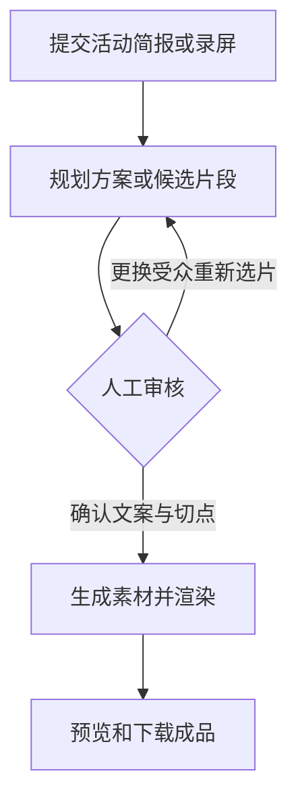

# 系统架构

UI 将活动简报或「录屏 + 选片要求」提交给 FastAPI。后台线程读取 SQLite 中排队的任务，返回待审核方案。用户确认后，线程才制作成品。

## 模块定位

| 想看什么 | 从哪几个文件找 |
| --- | --- |
| 工作台和任务列表 | [`ui/src/main.tsx`](../ui/src/main.tsx) |
| 新建任务、审核编辑、预览下载 | [`ui/src/forms.tsx`](../ui/src/forms.tsx)、[`ui/src/detail.tsx`](../ui/src/detail.tsx) |
| 前端接口请求和任务类型 | [`ui/src/api.ts`](../ui/src/api.ts) |
| HTTP 路由和输入约束 | [`app/main.py`](../app/main.py)、[`app/models.py`](../app/models.py) |
| 待审核状态、后台执行和重新导出 | [`app/workflow.py`](../app/workflow.py)、[`app/store.py`](../app/store.py) |
| 预热方案、台词和时间码如何计算 | [`app/planning.py`](../app/planning.py) |
| 图像和视频如何生成与合成 | [`app/providers.py`](../app/providers.py)、[`app/media.py`](../app/media.py) |

## 直播预热

1. `POST /api/tasks/promo` 写入活动名称、受众、时间、直播渠道和要点。样例模式整理填写的要点，实时模式请求文本模型生成结构化分镜和文案。
2. 用户审核后，`POST /api/tasks/{id}/promo-review` 交给后台渲染。活动时间来自已审核输入，海报、尾卡和群文案共用这个字段。
3. 重新确认改期会生成新成品版本。实时流程会按提示词复用已经生成的背景、开场镜头和旁白。

## 回放剪辑

1. `POST /api/tasks/clip` 接受 MP4 与 SRT。实时模式可将录屏音频切成分段再转写。字幕条目保留原片的绝对时间码。
2. 规划层按受众、字幕和时长约束返回候选。实时模型需要返回候选的字幕索引，实际切点由程序映射到原片时间。页面支持按时间码预览并微调。
3. `POST /api/tasks/{id}/clip-review` 校验时长和切点后生成实际剪辑。程序先把截取的字幕换算到从零开始的时间轴，再由 FFmpeg 压入成片。成品记录附所用原话和原片区间。

任务轮询接口是 `GET /api/tasks/{id}`。通常会从排队、执行、待审核进入第二次排队和执行，最终生成可下载成品。中断或失败的任务可使用 `POST /api/tasks/{id}/retry` 继续当前步骤。

## 状态与成品落盘

SQLite 记录任务状态、用户输入、候选、审批结果与成品版本。业务素材在 `data/tasks/<任务 ID>/` 保存。只有文件完整导出后，任务的当前版本才更新。下载 URL 可以带版本参数 `v` 访问指定成品。默认运行一个 Uvicorn 工作进程和一个后台媒体线程，每个任务的数据目录独立。
